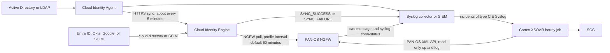

# Cloud Identity Engine Sync Monitor

Hourly Cortex XSOAR check for two failures:

- Cloud Identity Engine directory data has not synced to a Palo Alto Networks NGFW within the last hour.
- CIE syslog has stopped. The default heartbeat is an XSOAR incident of type **CIE Syslog** in the last hour.

A healthy run closes the job incident. A finding stays open as one **CIE Sync Failure** incident, and the job incident still closes so the next hour can run.

## Communications



The repository README has the same diagram plus the hour-by-hour sequence.

## Install

```bash
cd Packs
zip -r CIESyncMonitor.zip CIESyncMonitor
```

Upload the zip as Cortex XSOAR custom content. `pack_metadata.json` must be at the root of the zip.

Create a PAN-OS admin role with XML API, operational read, and log read. No commit and no configuration edit. Store that user in the Palo Alto Networks PAN-OS integration. The integration generates the API key. Do not put the key in a playbook input.

On each firewall, enable a Cloud Identity Engine profile whose region matches the CIE instance, install the device certificate, and use a CIE user or group in security policy. The firewall does not pull directory attributes that policy does not reference.

Forward CIE syslog into XSOAR as incident type **CIE Syslog** before you enable the silence check.

## Job

**Jobs**, **New Job**, **Time triggered**, recurring, cron `0 * * * *`, time zone **America/New_York**.

| Field | Value |
| --- | --- |
| Incident type | CIE Sync Monitor Run |
| Playbook | CIE - Sync and Syslog Monitor |
| Severity | Low |
| Queue handling | Don't trigger a new job run |

| Playbook input | Value |
| --- | --- |
| Devices | `edge-fw:SERIAL,core-fw:SERIAL` |
| Using | PAN-OS instance name |
| ApiCommand | `panorama`, or `pan-os` for a firewall |
| UseTarget | `true` for Panorama, `false` for a firewall |
| SyncMaxAgeMinutes | `60` |
| SyslogMaxAgeMinutes | `60` |
| SyslogHeartbeatSource | `xsoar-incidents` |
| SyslogHeartbeatQuery | `type:"CIE Syslog"` |
| DeviceTimeOffsetMinutes | `0` when the firewall clock is UTC. US Eastern Standard Time is `-300`. |
| NotifyEmail | SOC address, or empty to skip mail |

The firewall CIE profile Update Interval defaults to 60 minutes, the same window as this alert. A healthy pull that lands just after the job can look late. Set that firewall interval to 30 minutes, or set `SyncMaxAgeMinutes` to `90`.

`cas-message` is a CIE error, not a heartbeat. A quiet system log is healthy. Set `SyslogHeartbeatSource` to `disabled` until **CIE Syslog** incidents are arriving.

Do not attach this playbook to **CIE Sync Failure**.

## Findings

| Status | Meaning |
| --- | --- |
| sync_stale | No sync evidence newer than the threshold. |
| sync_failed | The firewall or a heartbeat event reported an error, including `SYNC_FAILURE`. |
| cas_message | The firewall logged a CIE problem. |
| syslog_down | `syslog-conn-status` reports a failed syslog connection. |
| syslog_silent | The heartbeat query returned nothing in the window. |
| sync_check_error | The API call or the state list could not be read. The run does not report healthy. |

The first run that only has an update counter baselines that counter and does not page. The next hour pages if the counter did not move. The list `CIE-Sync-Monitor-State` holds those counters.

Commands used on the firewall:

```
show user cloud-identity-engine statistics all
show user group-mapping statistics
```

System log query:

```
(receive_time geq '<window>') and ((eventid eq 'cas-message') or (eventid eq 'syslog-conn-status'))
```

## Tests

```bash
python3 -m pytest Packs/CIESyncMonitor/Scripts/CIESyncHealthCheck/CIESyncHealthCheck_test.py
```
