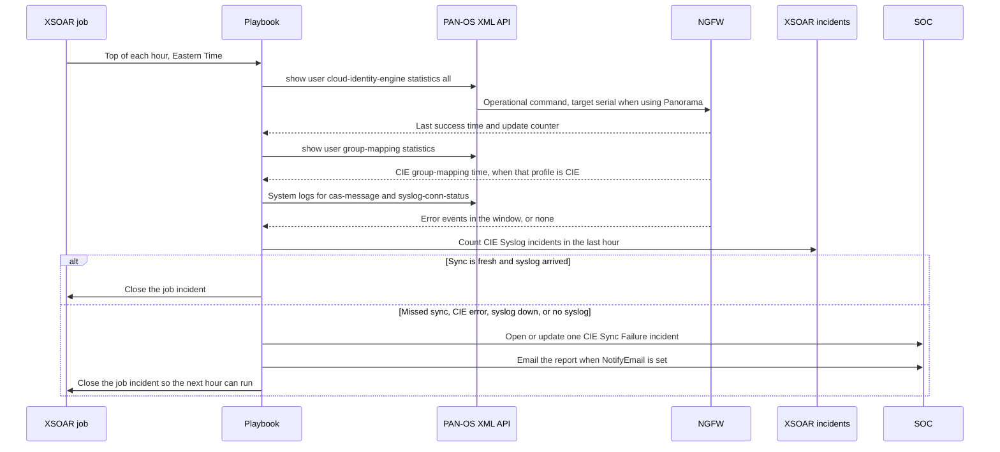

# Cloud Identity Engine sync and syslog monitor

Cortex XSOAR playbook and hourly job that alert when Palo Alto Networks Cloud Identity Engine (CIE) stops syncing to NGFWs, or stops sending the syslog you use as its heartbeat.

The check runs every hour. It alerts when the newest sync evidence on a firewall is **60 minutes or older**, and when the CIE syslog heartbeat has **no events in the last 60 minutes**. A healthy run closes the job incident. A finding stays open as a **CIE Sync Failure** incident and can be emailed to the SOC.

The pack is `Packs/CIESyncMonitor`. API keys stay in the PAN-OS integration. Nothing in this repository is a credential.

## Communication paths

Directory data and syslog take different paths. The hourly job reads both, from the firewall for sync and from the place syslog actually lands for silence.

```mermaid
flowchart LR
  subgraph sources [Identity sources]
    AD["On-prem Active Directory or LDAP"]
    CloudDir["Entra ID, Okta, Google, or SCIM"]
  end

  Agent["Cloud Identity Agent"]
  CIE["Cloud Identity Engine<br/>Directory Sync and Cloud Authentication Service"]
  NGFW["PAN-OS NGFW"]
  Panorama["Panorama"]
  Collector["Syslog collector, Strata Logging Service, or SIEM"]
  XSOAR["Cortex XSOAR"]
  SOC["SOC"]

  AD -->|"LDAP fetch"| Agent
  Agent -->|"HTTPS directory sync<br/>incremental about every 5 minutes"| CIE
  CloudDir -->|"cloud directory or SCIM"| CIE
  CIE -->|"Firewall pulls on the CIE profile interval<br/>default 60 minutes, range 1 to 1440<br/>Palo Alto Networks Services route and device certificate"| NGFW
  NGFW --- Panorama
  Agent -->|"optional agent or directory-sync syslog"| Collector
  CIE -->|"Directory Sync logs<br/>SYNC_START, SYNC_IN_PROGRESS, SYNC_SUCCESS, SYNC_FAILURE"| Collector
  NGFW -->|"system syslog<br/>cas-message and syslog-conn-status"| Collector
  Collector -->|"fetch incidents of type CIE Syslog"| XSOAR
  XSOAR -->|"hourly job runs the playbook"| XSOAR
  XSOAR -->|"XML API key, type=op and type=log<br/>read-only operational and log role"| Panorama
  Panorama -->|"target=firewall serial"| NGFW
  XSOAR -->|"CIE Sync Failure incident and email"| SOC
```



The hourly conversation looks like this:



## What is checked

| Evidence | Healthy | Alert |
| --- | --- | --- |
| Last CIE success time on the firewall | Younger than 60 minutes | `sync_stale` |
| CIE update counter, when the output has no timestamp | Counter increased, or it is still inside the first window after a baseline | `sync_stale` when it stays flat for 60 minutes |
| `last-error`, or heartbeat text `SYNC_FAILURE` | Empty or success | `sync_failed` |
| System log `cas-message` | No events. These are CIE problems, not a heartbeat | `cas_message` |
| System log `syslog-conn-status` with a failure | Established or no event | `syslog_down` |
| CIE syslog heartbeat | At least one event in 60 minutes | `syslog_silent` |
| API, list, or query error | Command succeeded | `sync_check_error` or `syslog_check_error` |

`cas-message` is the firewall event for a CIE problem such as an expired certificate or a missing identity provider profile. The firewall records that check on its own schedule. A quiet system log is healthy. Silence is measured only on the heartbeat you configure.

The first run that sees only an update counter, with no timestamp, stores that counter and does not page. The next hour pages if the counter did not increase. A timestamp that is already older than the threshold pages on the first run. Deleting the list `CIE-Sync-Monitor-State` starts that baseline over.

Group-mapping output is used only for profiles that identify themselves as Cloud Identity Engine. An on-box LDAP group mapping is not treated as CIE.

Severity is **High** for a missed sync or silent syslog. It is **Critical** when the firewall or the heartbeat reports an explicit failure (`sync_failed`, `cas-message`, or syslog connection down).

## Firewall interval and the one-hour alert

CIE directory sync in the cloud is about every five minutes. The firewall pulls that data on the Cloud Identity Engine profile **Update Interval**. The default is 60 minutes, and the range is 1 to 1440.

This job also runs every 60 minutes and alerts at 60 minutes. A healthy firewall whose pull lands just after the job can look late. Use either of these:

- Set the firewall CIE profile Update Interval to 30 minutes or less, and leave the playbook threshold at 60.
- Leave the firewall at 60 minutes and set the playbook input `SyncMaxAgeMinutes` to 90, so one missed hourly pull alerts and a healthy pull does not.

The pack default is 60, which is the one-hour alert.

## Before the job is enabled

1. Install the device certificate on the firewall or Panorama and activate the Cloud Identity Engine instance. The region on the firewall profile must match the CIE instance.
2. Configure the directory in the CIE app: on-prem Active Directory through the Cloud Identity Agent, or a cloud directory such as Entra ID.
3. On the firewall, add a Cloud Identity Engine profile under Device, User Identification, Cloud Identity Engine. Leave it enabled. The profile uses the Palo Alto Networks Services service route.
4. Reference at least one user or group from that directory in security policy. The firewall retrieves attributes only for users and groups used in policy.
5. Confirm a manual check on the firewall:

   ```
   show user cloud-identity-engine statistics all
   show user group-mapping statistics
   ```

6. Forward CIE syslog into Cortex XSOAR as incidents of type **CIE Syslog**. That type is in this pack and has no playbook. A fetch integration or classifier sets the type. Directory-sync logs that include `SYNC_FAILURE` are treated as a failed sync even when other events arrived.
7. Create a read-only PAN-OS API admin and add the Palo Alto Networks PAN-OS integration in XSOAR. Steps are in the next section.
8. Import this pack, then create the hourly job. Leave the job disabled until one **CIE Syslog** incident has arrived, or set `SyslogHeartbeatSource` to `disabled` until that ingestion is ready. Otherwise the first run reports silent syslog.

Strata Cloud Manager is where many deployments assign the firewall and the CIE region. This monitor does not call the Strata Cloud Manager API. Sync evidence is on the NGFW, read with the PAN-OS XML API. Strata Cloud Manager uses its own OAuth client credentials and TSG, described in the [Strata Cloud Manager API](https://pan.dev/strata-cloud-manager/) docs.

## API access

Follow [NGFW API authentication](https://docs.paloaltonetworks.com/ngfw/api/api-authentication-and-security). The playbook never sees the password or the API key.

1. Create an admin role with XML API enabled, Operational Requests read, and Log read. Do not grant commit, configuration edit, or packet capture.
2. Create an admin user and assign that role.
3. In Cortex XSOAR, add the Palo Alto Networks PAN-OS integration. Point it at Panorama, or at one firewall. Enter the admin user and password and run Test. The integration generates the API key with `type=keygen` and stores it.
4. A key can be generated by hand with `https://<host>/api/?type=keygen&user=<user>&password=<password>`. Keep that key in the integration credential store. Do not put it in this repository, a playbook input, or a list.
5. For Panorama, set playbook input `UseTarget` to `true` and `Devices` to `name:serial` pairs. The operational command is sent with `target=<serial>` so it runs on that firewall. System logs are queried once against Panorama, which requires system logs to be forwarded to Panorama. Set `QueryEachDevice` to `true` to query each firewall instead.
6. For a single firewall integration, set `ApiCommand` to `pan-os`, `UseTarget` to `false`, and `Devices` to a display name.

The automation runs these API calls:

| Call | Purpose |
| --- | --- |
| `type=op` `show user cloud-identity-engine statistics all` | Last sync time and update counter on the firewall |
| `type=op` `show user group-mapping statistics` | CIE group-mapping time, when the profile is Cloud Identity Engine |
| `type=log` system log query `(receive_time geq '<window>') and ((eventid eq 'cas-message') or (eventid eq 'syslog-conn-status'))` | CIE errors and syslog disconnects |

Timestamps printed by the firewall are read as UTC unless `DeviceTimeOffsetMinutes` is set. Use `0` when the firewall clock is UTC. US Eastern Standard Time is `-300`, and US Eastern Daylight Time is `-240`. NTP set to UTC avoids that change twice a year.

## Import the pack

From this repository:

```bash
cd Packs
zip -r CIESyncMonitor.zip CIESyncMonitor
```

The zip root must contain `pack_metadata.json`. In Cortex XSOAR, upload it as custom content. The upload adds:

| Object | Name | Role |
| --- | --- | --- |
| Playbook | CIE - Sync and Syslog Monitor | The hourly check |
| Automation | CIESyncHealthCheck | PAN-OS and heartbeat logic |
| Incident type | CIE Sync Monitor Run | The job incident, closed every run |
| Incident type | CIE Sync Failure | The open alert. No playbook is attached |
| Incident type | CIE Syslog | Heartbeat incidents from your syslog ingestion |

## Create the hourly job

In Cortex XSOAR 6 or 8: **Jobs**, **New Job**, **Time triggered**.

| Field | Value |
| --- | --- |
| Name | CIE - Hourly Sync and Syslog Monitor |
| Recurring | On. Cron view: `0 * * * *` |
| Time zone | America/New_York |
| Incident type | CIE Sync Monitor Run |
| Severity | Low |
| Playbook | CIE - Sync and Syslog Monitor |
| Queue handling | Don't trigger a new job run |

The cron runs at minute 0 of every hour. With the job time zone set to America/New_York, that is the top of each hour Eastern. A copy of these fields is in `docs/job-CIE_Hourly_Sync_and_Syslog_Monitor.json`. XSOAR does not import that file. Create the job in the UI.

Set the playbook inputs on the job:

| Input | Example |
| --- | --- |
| Devices | `edge-fw:012345678901,core-fw:012345678902` |
| Using | The PAN-OS integration instance name |
| ApiCommand | `panorama` or `pan-os` |
| UseTarget | `true` for Panorama, `false` for a firewall |
| SyncMaxAgeMinutes | `60` |
| SyslogMaxAgeMinutes | `60` |
| SyslogHeartbeatSource | `xsoar-incidents` |
| SyslogHeartbeatQuery | `type:"CIE Syslog"` |
| DeviceTimeOffsetMinutes | `0` when the firewall is UTC |
| NotifyEmail | The SOC address. Empty skips mail |
| CheckFirewallLogs | `true` |
| QueryEachDevice | `false` unless system logs are not on Panorama |

The playbook closes the job incident on every successful run, including runs that open an alert. That matches the [XSOAR job guidance](https://docs-cortex.paloaltonetworks.com/r/Cortex-XSOAR/8.7/Cortex-XSOAR-On-prem-Documentation/Create-a-time-triggered-job): the next hour must not start while the previous job incident is still active. Queue handling is the backup if a task errors before the close. If a run errors, close that **CIE Sync Monitor Run** incident or the following hour will not start.

Do not set the **CIE Sync Failure** incident type to run this playbook. That would check CIE by opening another CIE failure.

## What the SOC sees

A healthy hour closes a low-severity **CIE Sync Monitor Run**. The war room has a table of each firewall, the last success time in Eastern Time and UTC, and the heartbeat count.

An unhealthy hour does the same close, and leaves one **CIE Sync Failure** incident open. Later hours update that incident instead of opening another. The report name looks like `CIE alert: sync_stale on edge-fw`.

| Finding | Where to look |
| --- | --- |
| Sync older than the threshold | Cloud Identity Agent, directory connectivity, device certificate, CIE region, and the Palo Alto Networks Services route. On the firewall, `show user cloud-identity-engine statistics all`. Confirm the user or group is used in security policy. |
| Sync failed or `SYNC_FAILURE` | The directory named in the finding. CIE Directory Sync logs record `event_state` of `SYNC_FAILURE` and a failure reason. |
| `cas-message` | The system log text in the finding. Typical causes are an expired certificate or a missing identity provider profile. |
| Syslog connection failed | The syslog server, the syslog profile, and `syslog-conn-status` on the firewall. |
| No CIE syslog | The collector, the XSOAR fetch integration, and whether CIE is still emitting. This is the "stopped sending syslog" alert. |

Close the **CIE Sync Failure** incident after the path is healthy. The next hour stays quiet when evidence is fresh and no older alert is still open.

Other heartbeat sources:

- `pan-os-log` counts PAN-OS system logs that match `SyslogHeartbeatQuery` inside the window. The default filter is `opaque contains 'Cloud Identity'`. Use this only when the firewall actually writes a CIE log at least once an hour. `cas-message` does not.
- `xsiam-xql` runs `xdr-xql-generic-query` with your XQL. Include the time window in the query, for example a filter on the last hour, and include Directory Sync `event_state` values if those logs are in Strata Logging Service.
- `disabled` skips the silence check. Firewall `cas-message` and `syslog-conn-status` are still read when `CheckFirewallLogs` is true.

## Repository layout

```
Packs/CIESyncMonitor/
  pack_metadata.json
  Playbooks/playbook-CIE_Sync_and_Syslog_Monitor.yml
  Scripts/CIESyncHealthCheck/
  IncidentTypes/
docs/job-CIE_Hourly_Sync_and_Syslog_Monitor.json
```

Run the unit tests from the repository root:

```bash
python3 -m pytest Packs/CIESyncMonitor/Scripts/CIESyncHealthCheck/CIESyncHealthCheck_test.py
```

The tests cover timestamp parsing, the firewall counter baseline, a missed hour, `cas-message`, silent syslog, and an API error. They do not call a live firewall.

## References

- [Cloud Identity Engine in PAN-OS 10.1](https://docs.paloaltonetworks.com/pan-os/10-1/pan-os-new-features/identity-features/cloud-identity-engine). Device certificate, CIE profile, 60-minute default firewall update interval, and the five-minute directory sync.
- [Monitor Cloud Identity Engine status](https://docs.paloaltonetworks.com/identity/cloud-identity-engine/troubleshoot-the-cloud-identity-engine/monitor-cloud-identity-engine-status). Firewall system log `cas-message`.
- [Cloud Identity Engine troubleshooting checklist](https://docs.paloaltonetworks.com/identity/cloud-identity-engine/troubleshoot-the-cloud-identity-engine/cloud-identity-engine-troubleshooting-checklist). Agent, directory, and sync status.
- [Forward CIE logs to Strata Logging Service](https://docs.paloaltonetworks.com/identity/cloud-identity-engine/manage-the-cloud-identity-engine/manage-the-cloud-identity-agent/configure-cloud-identity-agent-logs/forward-logs-to-strata-logging-service). `SYNC_SUCCESS` and `SYNC_FAILURE`.
- [Cortex XSOAR playbooks](https://xsoar.pan.dev/docs/playbooks/playbooks-overview).
- [Create a time-triggered XSOAR job](https://docs-cortex.paloaltonetworks.com/r/Cortex-XSOAR/8.7/Cortex-XSOAR-On-prem-Documentation/Create-a-time-triggered-job).
- [Strata Cloud Manager API](https://pan.dev/strata-cloud-manager/). Management-plane API. This pack reads sync evidence from the NGFW XML API instead.
- [NGFW API authentication and security](https://docs.paloaltonetworks.com/ngfw/api/api-authentication-and-security).

`https://github.com/mikewood33/cursorHelp` is not a repository GitHub can see from this account, so this pack follows the Cortex XSOAR content-pack layout and the Palo Alto documents above.
